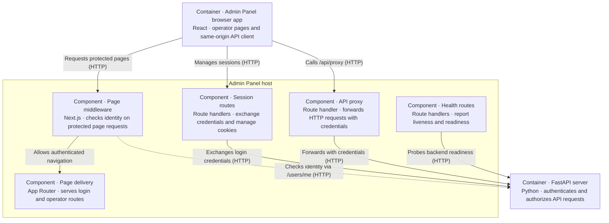

# Standalone Admin Panel architecture

The Admin Panel is the operator console in [`admin-ui/`](../../admin-ui/). Its Next.js App Router host runs on port 3001 by default and ships with its own build and dependency lockfile. The [end-user WebUI](./webui.md) has a separate set of `/admin/*` pages that use the WebUI connection and session. Both surfaces reach the same [FastAPI server](./server.md).

See the [system and container views](./c4.md) for the Admin Panel's place in tldw_server.

## C4 level 3 — Admin Panel host components

The boundary contains the Next.js server components. The Admin Panel browser app and FastAPI are supporting containers. Labeled arrows point from the requester to the component or container it calls. The dashed arrow is the backend validation path used when middleware needs a remote credential check.

### Trace an admin request

1. Start at [Admin Panel navigation](../../admin-ui/lib/navigation.ts) to find the page, or use [the browser API client](../../admin-ui/lib/api-client.ts) to find the request it sends. [PermissionGuard](../../admin-ui/components/PermissionGuard.tsx) uses effective permissions to control what the UI shows.
2. A user list request to `/api/proxy/admin/users` reaches the [host proxy](../../admin-ui/app/api/proxy/%5B...path%5D/route.ts). The proxy attaches the credential server-side and forwards to `/api/v1/admin/users` under the default API version.
3. The [FastAPI admin router](../../tldw_Server_API/app/api/v1/endpoints/admin/__init__.py) gates admission before the [user-list handler](../../tldw_Server_API/app/api/v1/endpoints/admin/admin_user.py) runs. The API enforces the role, permissions and scope required by each operation. The [admin router registry](../../tldw_Server_API/app/api/v1/router_groups/admin.py) also includes specialized operations across multiple route families, so begin with the exact API path when tracing Jobs or organization actions. [AuthNZ architecture](./authnz.md) explains the backend identity and authorization model.

Protected page navigation goes through [middleware](../../admin-ui/middleware.ts). Login and API requests go straight to their respective route handlers. [Session routes](../../admin-ui/app/api/auth/) manage HttpOnly credential cookies, and the [server auth helper](../../admin-ui/lib/server-auth.ts) translates those cookies into the upstream authorization headers.

## Authoritative files

All paths under `admin-ui/` unless noted.

| Concern | File | Key symbols |
| --- | --- | --- |
| Auth edge | `middleware.ts` | token validation with an in-process LRU cache (hashed keys); local HS256/384/512 JWT verify with secondary-secret rotation support; backend `/users/me` fallback probe; matcher excludes `/login`, `/api`, `_next`, files |
| Server proxy | `app/api/proxy/[...path]/route.ts` | rewrites to `${NEXT_PUBLIC_API_URL}/api/${version}`, 30 s timeout, one GET-only retry, 502/504 mapping |
| Cookie handling | `lib/server-auth.ts` | httpOnly cookie constants; cookie → `Authorization: Bearer` / `X-API-KEY`; safe-header passthrough allowlist; `set-cookie` stripped from responses |
| Login routes | `app/api/auth/{login,mfa/login,apikey,logout}/route.ts` | forwards to backend auth; **strips tokens from the JSON the browser sees**; logout invalidates the middleware cache |
| Health | `app/api/health{,/ready}/route.ts` | liveness; readiness probes backend `/health` (503 when down) |
| Browser API | `lib/http.ts`, `lib/api-client.ts` (typed client), `lib/api-config.ts` | everything is `/api/proxy<endpoint>`; real-backend E2E port map |
| Client auth | `lib/auth.ts` | non-httpOnly session-marker polling + auth-change events |
| Rate limiting | `lib/rate-limiter.ts` | 10 req / 60 s per IP (requires `TRUST_PROXY_HEADERS` behind a proxy) |
| Env/flags | `lib/env.ts`, `lib/admin-ui-flags.ts` | zod-validated `NEXT_PUBLIC_*` at build; the unsafe-local-tools gate for DSR/backup/monitoring mutations |
| Build | `next.config.mjs` | standalone output (repo-root tracing); full CSP/HSTS headers |
| Packaging | `Dockerfiles/Dockerfile.admin-ui`, `Dockerfiles/docker-compose.admin-ui.yml` | bun builder → node:20-slim runtime, non-root UID, healthcheck against `/api/health/ready`; starts only after the backend is healthy |
| Backend counterpart | `tldw_Server_API/app/api/v1/endpoints/admin/__init__.py`, `app/api/v1/router_groups/admin.py`, `app/api/v1/endpoints/test_support/admin_e2e.py` | admin router, related route families and the flag-gated E2E test-support router |

## Login (dataflow)

1. Browser POSTs credentials to same-origin `/api/auth/login` (rate-limited).
2. The route forwards to backend `/api/v1/auth/login`, then sets **httpOnly** cookies (`access_token`, optional refresh, plus non-httpOnly `admin_session`/`admin_auth_mode` markers) and returns the payload **with the tokens deleted** — browser JS never sees them. MFA follows the same shape.
3. The client polls for the session marker, fetches `/users/me` through the proxy, and emits an auth-change event.

API-key login (single-user convenience) is **triple-gated**: refused if enterprise mode is on, if not explicitly enabled, or if the backend is not in single-user mode; the enterprise flag hard-disables it regardless.

## Page request and privileged call (dataflow)

1. Edge middleware checks cookies (then headers): JWT verified **locally** when `JWT_SECRET_KEY` is present, else via a backend probe; results cached (positive ≤30 s bounded by token expiry, negative 5 s, LRU cap).
2. Unauthenticated → redirect to `/login?redirectTo=…`; otherwise the response carries a request id.
3. Page code calls the typed client → same-origin `/api/proxy/admin/...` → the proxy attaches the server-side credential from cookies, passes safe headers, and maps timeout → 504 / network error → 502 (GET retried once).

## Failure behaviors (verified)

| Case | Behavior |
| --- | --- |
| Backend down via proxy | 504 (30 s timeout) / 502 (network); GET-only single retry |
| Backend down at readiness | 503 (Docker healthcheck fails) |
| Login rate limit | 429 + `Retry-After` |
| Revoked token | Remote validation can cache a prior success for up to 30 s per instance. Locally verified JWTs can pass page middleware until expiry. FastAPI independently enforces API access. |
| Backend `set-cookie` | Stripped — backend sessions never reach the browser |
| Malformed/oversized tokens | Rejected pre-verification (length/charset caps) |

## Config keys (exact)

Build-time (baked into the client bundle; changes require a rebuild): `NEXT_PUBLIC_API_URL` (default `http://localhost:8000`), `NEXT_PUBLIC_API_VERSION` (v1), `NEXT_PUBLIC_DEFAULT_AUTH_MODE`, `NEXT_PUBLIC_ALLOW_ADMIN_API_KEY_LOGIN` (false), `NEXT_PUBLIC_BILLING_ENABLED` (false), `NEXT_PUBLIC_ADMIN_UI_ENABLE_UNSAFE_LOCAL_TOOLS` (false), `NEXT_PUBLIC_SENTRY_DSN`. Runtime: `JWT_SECRET_KEY` / `JWT_SECONDARY_SECRET` / `JWT_ALGORITHM`, `ADMIN_UI_ALLOW_API_KEY_LOGIN` (false), `ADMIN_UI_ENTERPRISE_MODE`, `AUTH_MODE`, `TRUST_PROXY_HEADERS` (false), `SERVER_X_API_KEY`, `SENTRY_AUTH_TOKEN`, `ADMIN_UI_PORT` (3001). E2E: `TLDW_ADMIN_E2E_*` family plus the backend's `ENABLE_ADMIN_E2E_TEST_MODE`.

## Verified gotchas

1. Two stacks, two lockfiles — admin-ui vs the `apps/` monorepo; also two Next versions and two React versions. Cross-imports are the classic breakage.
2. Each instance keeps its own in-memory validation cache.
3. Without `JWT_SECRET_KEY`, a cache miss for a protected page request requires a backend probe.
4. The middleware matcher excludes `/api/*`; API routes enforce their own auth (the proxy reads cookies server-side).
5. `ai-overview` and `invitations` pages exist but are missing from the README's feature list (minor drift).
6. The proposed ADR-029 keeps admin-ui outside the PyPI static bundle (its middleware/app-routes design needs a separate one).

## Governing decisions and docs

See [ADR-018](../ADR/018-resource-governance-endpoint-policy-and-route-map.md) for claim-first endpoint authorization and [ADR-017](../ADR/017-scoped-org-team-rbac-core-semantics.md) for scoped organization and team permissions. The proposed [ADR-029](../ADR/029-tldw-frontend-static-pypi-bundle.md) covers the end-user WebUI. Current references: `admin-ui/README.md`, `admin-ui/docs/{architecture,api-reference,deployment-guide,troubleshooting}.md`, feature guides, the living `Release_Checklist.md`. Tests: colocated Vitest (incl. axe a11y lane), Playwright smoke (stubbed), and real-backend E2E (two sequential projects: JWT and single-user, port-mapped against real backends, `--workers=1`).

## Related docs

- [authnz.md](./authnz.md) — the backend auth the console drives
- [sdks.md](./sdks.md) — the other client surfaces
