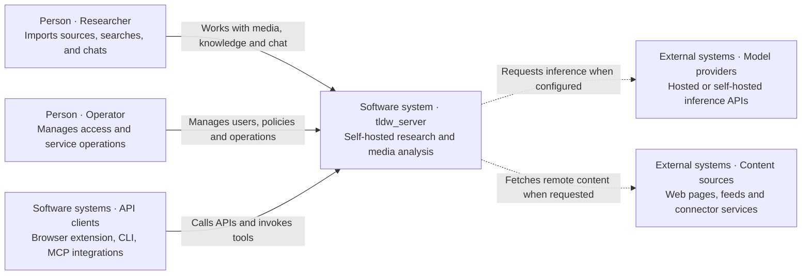
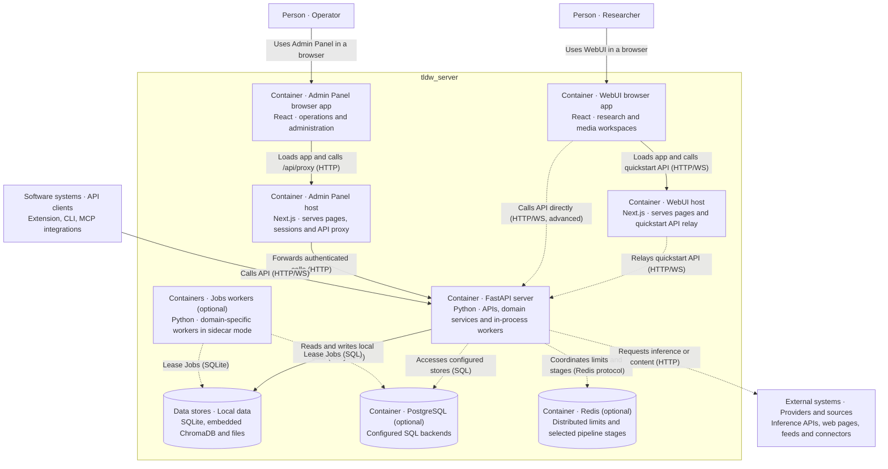

# tldw_server architecture with C4

Start with the context diagram to see who uses tldw_server and which external systems it talks to. Use the container diagram to trace a request across runtimes, then follow the component view for the application you want to change. Each component view links to code entry points and the relevant [subsystem guides](./README.md).

[C4 uses progressively narrower views](https://c4model.com/diagrams). In these diagrams, labels identify people, software systems, containers and components. Labeled arrows point from the initiator to the dependency. Dashed arrows mark paths that depend on a build choice, configuration, or deployment. A C4 container is a running application or data store. Docker is one way to package and run it.

## C4 level 1 — System context

The boundary covers the FastAPI server, end-user WebUI and standalone Admin Panel. The browser extension, CLI tools and MCP integrations appear as clients of this boundary.

## C4 level 2 — Containers and data stores

The WebUI and Admin Panel each ship as a Next.js application. The diagrams show their browser JavaScript and Node.js hosts separately because they execute in different places. Both applications use the same FastAPI backend. They have distinct connection and session paths.

- **WebUI.** Quickstart uses the WebUI origin for API traffic, including HTTP streaming and WebSocket URLs. The host relays requests to FastAPI. Advanced builds use a browser-visible API origin. See the [WebUI component and connection guide](./webui.md).
- **Admin Panel.** The browser calls the Admin Panel host. Its server-side proxy attaches the applicable session credential, and FastAPI applies each endpoint's authorization rules. The end-user WebUI also exposes some admin pages through its own client. See the [Admin Panel component and authorization guide](./admin-ui.md).
- **FastAPI.** The API owns domain logic, applies authorization and coordinates storage and background execution. Jobs workers can run inside the API process or, for selected job domains, as separate processes that share the SQL-backed queue. Enabled job handlers can also fetch remote content or call providers. PostgreSQL selection is per backend. Redis supports configured features such as distributed limits and staged embeddings. See the [FastAPI component guide](./server.md), [database layer](./database-layer.md) and [Jobs and Scheduler](./jobs-background.md).

The Docker overlays show the runtime wiring for the [WebUI](../../Dockerfiles/docker-compose.webui.yml), [Admin Panel](../../Dockerfiles/docker-compose.admin-ui.yml) and [Jobs sidecars](../../Dockerfiles/docker-compose.workers.yml). Use the [architecture index](./README.md) to find the guide for a specific module.
