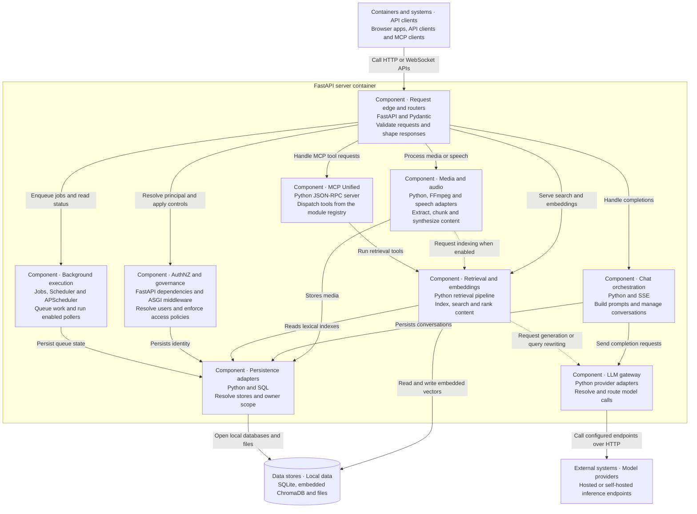

# C4 level 3 — FastAPI server components

The [system context and container views](./c4.md) show how clients and services
connect. This view opens the **FastAPI server** container and follows the
components that handle a request, access data, or dispatch background work.
The [architecture index](./README.md) links to the remaining subsystems.

Boxes inside the FastAPI boundary are in-process components. Solid arrows show
the main interaction paths. Dotted arrows show paths that depend on the feature
or deployment configuration. SQLite and ChromaDB use embedded clients with
filesystem storage. The [container view](./c4.md#c4-level-2--containers-and-data-stores) shows optional network stores.

AuthNZ accepts API keys and browser sessions in single-user mode and credentials
such as JWTs and sessions in multi-user mode. Recurring APScheduler services submit to Jobs or
to the internal Scheduler according to the feature. Optional Jobs worker
processes lease work from the same SQL-backed queue as the API. [Jobs and Scheduler decision](../ADR/003-jobs-vs-scheduler-default.md)

## Start in the code

| Component | Source entry point | Deeper guide |
| --- | --- | --- |
| Request edge and routers | [FastAPI entry point](../../tldw_Server_API/app/main.py), [router registry](../../tldw_Server_API/app/api/v1/router_registry.py) | [App shell](./app-shell.md) |
| AuthNZ and governance | [Auth dependencies](../../tldw_Server_API/app/api/v1/API_Deps/auth_deps.py), [ingress governor](../../tldw_Server_API/app/core/Resource_Governance/middleware_simple.py) | [AuthNZ](./authnz.md), [governance](./governance-billing.md) |
| Media and audio | [Media routes](../../tldw_Server_API/app/api/v1/endpoints/media/), [audio routes](../../tldw_Server_API/app/api/v1/endpoints/audio/audio.py) | [Ingestion](./ingestion.md), [audio](./audio.md) |
| Chat orchestration | [Chat routes](../../tldw_Server_API/app/api/v1/endpoints/chat.py), [completion pipeline](../../tldw_Server_API/app/core/Chat/completion_pipeline.py) | [Chat and characters](./chat-character.md) |
| Retrieval and embeddings | [Unified RAG pipeline](../../tldw_Server_API/app/core/RAG/rag_service/unified_pipeline.py), [embeddings core](../../tldw_Server_API/app/core/Embeddings/) | [RAG](./rag.md), [chunking and embeddings](./chunking-embeddings.md) |
| MCP Unified | [MCP routes](../../tldw_Server_API/app/api/v1/endpoints/mcp_unified_endpoint.py), [embedded server](../../tldw_Server_API/app/core/MCP_unified/server.py) | [MCP Unified](./mcp-unified.md) |
| LLM gateway | [LLM call entry point](../../tldw_Server_API/app/core/LLM_Calls/gateway.py) | [LLM providers](./llm-providers.md) |
| Persistence adapters | [Database paths](../../tldw_Server_API/app/core/DB_Management/db_path_utils.py), [content backend](../../tldw_Server_API/app/core/DB_Management/content_backend.py), [AuthNZ database](../../tldw_Server_API/app/core/AuthNZ/database.py) | [Database layer](./database-layer.md) |
| Background execution | [Lifespan startup](../../tldw_Server_API/app/services/lifespan_startup_sequence.py), [JobManager](../../tldw_Server_API/app/core/Jobs/manager.py) | [Jobs and background work](./jobs-background.md) |

## Trace a grounded chat reply

1. The WebUI RAG mode calls `POST /api/v1/rag/search` with generation disabled. The route resolves the user and their data sources. The RAG pipeline retrieves and ranks matching content. [RAG route](../../tldw_Server_API/app/api/v1/endpoints/rag_unified.py)
2. When it has evidence to use, the WebUI formats the retrieved passages into the prompt and sends a separate `POST /api/v1/chat/completions` request. [WebUI RAG mode](../../apps/packages/ui/src/hooks/chat-modes/ragMode.ts)
3. Chat assembles the completion request and calls the configured model through the LLM gateway. Streaming replies return as SSE. [Chat service](../../tldw_Server_API/app/core/Chat/chat_service.py)
