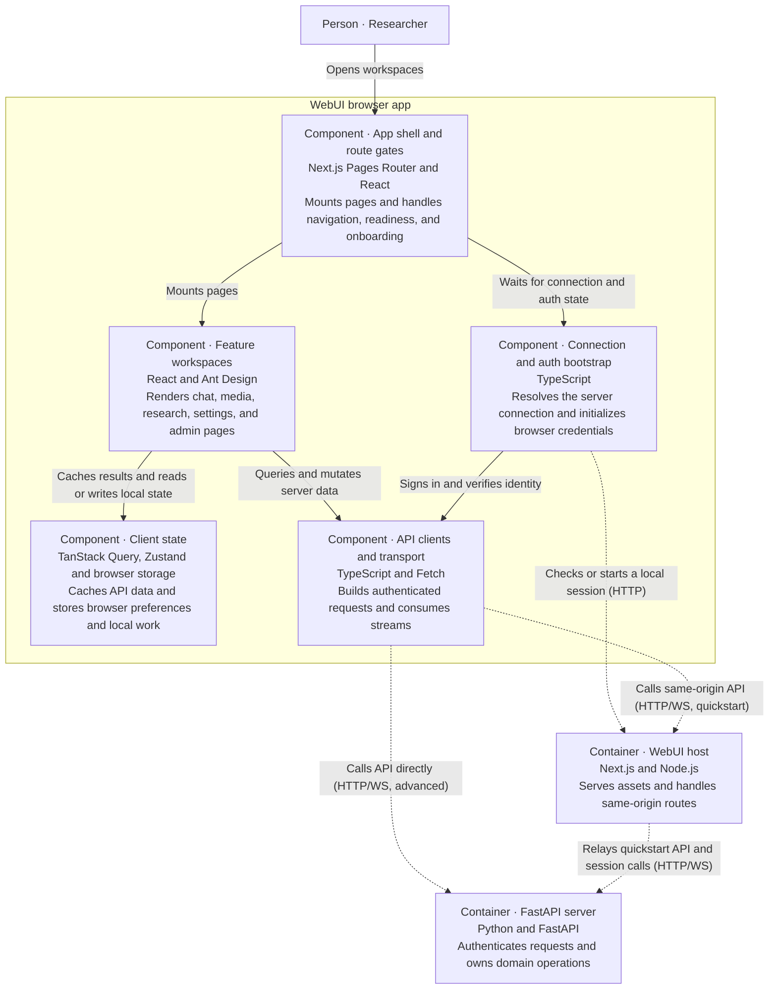

# WebUI

The WebUI serves chat, media, research, and other user workspaces. Its React app runs in the browser, and its Next.js host serves pages and assets and handles same-origin requests. Both ship from [apps/tldw-frontend](../../apps/tldw-frontend). See the [C4 context and container views](./c4.md) and the [architecture index](./README.md).

## C4 level 3 — WebUI browser app components

The boundary outlines the browser app. Boxes inside it are components. The person operates the app, and the two supporting containers are outside it. Arrows name each interaction. Dashed arrows indicate a build or configuration choice.

## Where the components live

| Component | Source and responsibility |
| --- | --- |
| App shell and route gates | [`pages/_app.tsx`](../../apps/tldw-frontend/pages/_app.tsx) wraps Pages Router pages with layout, connection, readiness, and first-run behavior. [`AppProviders.tsx`](../../apps/tldw-frontend/components/AppProviders.tsx) installs React Query and shared UI providers. |
| Feature workspaces | Many [`pages/` entries](../../apps/tldw-frontend/pages) load shared React screens from [`@tldw/ui`](../../apps/packages/ui/src). Some pages have WebUI-specific implementations. The WebUI's [`/admin/*` pages](../../apps/tldw-frontend/pages/admin) mount shared admin screens such as [Server Admin](../../apps/packages/ui/src/routes/option-admin-server.tsx). These screens use the WebUI connection and the FastAPI admin endpoints. The [standalone Admin Panel](./admin-ui.md) has its own deployment and auth proxy. |
| Connection and auth bootstrap | [`runtime-bootstrap.ts`](../../apps/tldw-frontend/extension/shims/runtime-bootstrap.ts) checks the local session capability, verifies a bootstrapped session against the API profile endpoint, and initializes client connection settings. Multi-user login is handled by [`TldwAuth.ts`](../../apps/packages/ui/src/services/tldw/TldwAuth.ts). |
| Client state | [`query-client.ts`](../../apps/packages/ui/src/services/query-client.ts) supplies the React Query cache. [Zustand stores](../../apps/packages/ui/src/store) hold UI state. [Web Storage shims](../../apps/tldw-frontend/extension/shims/plasmo-storage.ts) support preferences and connection settings, and the [Dexie schema](../../apps/packages/ui/src/db/dexie/schema.ts) defines browser-local records such as drafts and chat data. |
| API clients and transport | UI features call the shared [`TldwApiClient`](../../apps/packages/ui/src/services/tldw/TldwApiClient.ts) or the WebUI [`apiClient`](../../apps/tldw-frontend/lib/api.ts). Both use the [shared HTTP request core](../../apps/packages/ui/src/services/tldw/request-core.ts). [Browser networking](../../apps/packages/ui/src/services/tldw/browser-networking.ts) resolves the origin, and [WebSocket helpers](../../apps/packages/ui/src/services/tldw/browser-websocket.ts) handle socket URL selection. |

## How the WebUI host connects to FastAPI

| Profile | Request path |
| --- | --- |
| Docker quickstart | [The Compose overlay](../../Dockerfiles/docker-compose.webui.yml) publishes Next.js on `127.0.0.1:8080` from container port `3000`. The browser calls the WebUI origin. [Next.js rewrites](../../apps/tldw-frontend/next.config.mjs) forward `/api/*`, `/health`, and `/openapi.json` to the internal API origin, which defaults to `http://app:8000`. The WebSocket helper selects the WebUI origin too. Notifications use a [dedicated SSE relay](../../apps/tldw-frontend/lib/server/notification-stream-proxy.mjs). |
| Advanced or local development | The browser calls a configured HTTP(S) API origin. [Networking validation](../../apps/tldw-frontend/scripts/validate-networking-config.mjs) requires an absolute `NEXT_PUBLIC_API_URL` in advanced mode. The [build profiles](../../apps/tldw-frontend/scripts/build-with-profile.mjs) select quickstart for production and advanced for development. |

The opt-in local single-user flow uses two Next.js routes. [`runtime-config.ts`](../../apps/tldw-frontend/pages/api/_tldw-webui/runtime-config.ts) reports whether bootstrap is available. [`session.ts`](../../apps/tldw-frontend/pages/api/_tldw-webui/session.ts) uses the server-held API key to obtain the backend's session and CSRF cookies. The overlay leaves automatic provisioning disabled until the local setup profile enables it. See the [Docker single-user profile](../Getting_Started/Profile_Docker_Single_User.md) and [AuthNZ](./authnz.md).

The standalone host also exposes [documentation routes](../../apps/tldw-frontend/pages/api/documentation) that read bundled Markdown from [published docs](../Published). [The WebUI Dockerfile](../../Dockerfiles/Dockerfile.webui) packages the standalone server with its static assets.

## Trace a route from the browser to FastAPI

1. Open [`pages/research.tsx`](../../apps/tldw-frontend/pages/research.tsx) for the `/research` screen. Search for `runsQuery` to find the React Query call that loads the run list.
2. Follow `listResearchRuns` in [`lib/api/researchRuns.ts`](../../apps/tldw-frontend/lib/api/researchRuns.ts). It calls the WebUI API client with `/research/runs`. With the default API version, the request is `GET /api/v1/research/runs`.
3. In quickstart, match that path in [`next.config.mjs`](../../apps/tldw-frontend/next.config.mjs). In advanced mode, the client sends it directly to the configured API origin.
4. Find `list_research_runs` in [`endpoints/research_runs.py`](../../tldw_Server_API/app/api/v1/endpoints/research_runs.py). It resolves the authenticated user and lists the runs owned by that user. See [Research](./research.md) for the backend lifecycle.

For another route, start in [`pages/`](../../apps/tldw-frontend/pages) and follow its imports before looking up the API path. A page URL and an API route can have different names and ownership.
