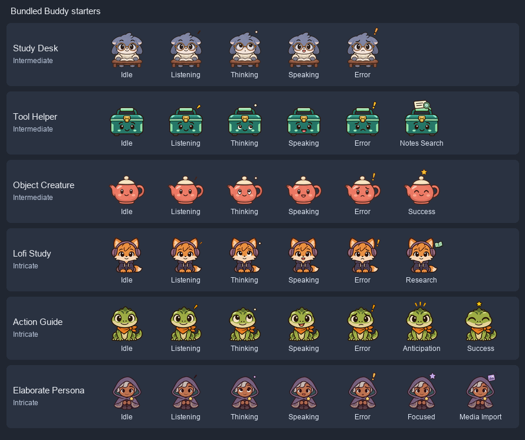

# Intermediate and intricate Buddy starter artwork

Six bundled defaults use the existing Persona Visual sprite format. The intermediate
packs ship individual RGBA frames. Each intricate pack ships one atlas with one
row per state and two 128 × 128 frames per row. Each pose uses the same canvas
and baseline so expression changes preserve the Buddy's position.

| Buddy | Identity and neutral anchor | Authored state | Source poses |
| --- | --- | --- | --- |
| Study Desk | Bespectacled companion behind an open book with paws on a wooden desk | Required states | [Model](assets/buddy-starters/study-desk-intermediate/model.png) · [Mouths](assets/buddy-starters/study-desk-intermediate/talking.png) · [Reactions](assets/buddy-starters/study-desk-intermediate/reactions.png) |
| Tool Helper | Teal toolbox resting on two feet with centered brass latch | `tool.notes_search` | [Model](assets/buddy-starters/tool-helper-intermediate/model.png) · [Mouths](assets/buddy-starters/tool-helper-intermediate/talking.png) · [Reactions](assets/buddy-starters/tool-helper-intermediate/reactions.png) |
| Object Creature | Coral teapot resting on its base with one spout and handle | `reaction.success` | [Model](assets/buddy-starters/object-creature-intermediate/model.png) · [Mouths](assets/buddy-starters/object-creature-intermediate/talking.png) · [Reactions](assets/buddy-starters/object-creature-intermediate/reactions.png) |
| Lo-fi Study | Seated amber fox with headphones and a violet hoodie | `tool.research` | [Model](assets/buddy-starters/lofi-study-intricate/model.png) · [Mouths](assets/buddy-starters/lofi-study-intricate/talking.png) · [Reactions](assets/buddy-starters/lofi-study-intricate/reactions.png) |
| Action Guide | Seated green lizard with orange neckerchief, short feet and one trailing tail | `reaction.anticipation`, `reaction.success` | [Model](assets/buddy-starters/action-guide-intricate/model.png) · [Mouths](assets/buddy-starters/action-guide-intricate/talking.png) · [Reactions](assets/buddy-starters/action-guide-intricate/reactions.png) |
| Elaborate Persona | Cloaked stargazer standing on two feet with a star clasp | `mood.focused`, `tool.media_import` | [Model](assets/buddy-starters/elaborate-persona-intricate/model.png) · [Mouths](assets/buddy-starters/elaborate-persona-intricate/talking.png) · [Reactions](assets/buddy-starters/elaborate-persona-intricate/reactions.png) |

Each pack has idle, listening, thinking, speaking and error loops. The first
model pose is the neutral anchor. The static mouth and reaction sheets show the
source poses before the timed loops are assembled. Existing custom state names,
triggers and fallback priorities carry over. Wake-armed uses listening, tool
running and approval use thinking, and offline uses idle. These fallbacks also
allow the existing Basic starters to pass the nine-state activation check.
Copy a starter as an inactive draft and review it before activating.

The artwork was created with image generation and prepared for this collection
by tldw-project. The six new sprite packs and associated source and preview
images use the [GNU Affero General Public License v3.0 only](../../LICENSES/AGPL-3.0-only.txt).
Each pack includes a provenance record.

ADR required: no. The [existing animation pipeline](../superpowers/specs/2026-05-16-buddy-animation-pipeline-design.md)
defines the production and activation contracts.
